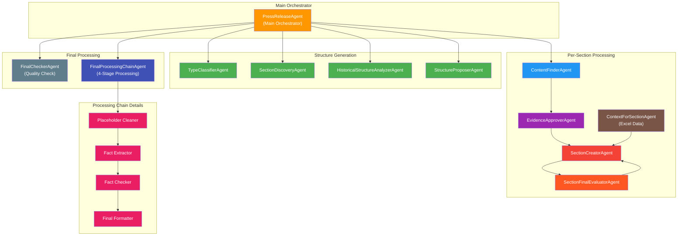

# Agent Flow Diagram

This Mermaid diagram represents the actual agent flow in `gui_new.py` implementation.

## Key Components

### Main Orchestrator
- **PressReleaseAgent**: Central control point for the entire process

### Structure Generation
- **TypeClassifierAgent**: Classifies the type of press release
- **SectionDiscoveryAgent**: Discovers relevant sections from historical data
- **HistoricalStructureAnalyzerAgent**: Analyzes successful structure patterns
- **StructureProposerAgent**: Proposes final template and structure

### Per-Section Processing
- **ContentFinderAgent**: Retrieves evidence for each section
- **EvidenceApproverAgent**: Validates evidence sufficiency
- **SectionCreatorAgent**: Creates content using evidence
- **SectionFinalEvaluatorAgent**: Evaluates and can send back for revision
- **ContextForSectionAgent**: Integrates Excel data as evidence

### Final Processing
- **FinalCheckerAgent**: Quality check of final content
- **FinalProcessingChainAgent**: 4-stage processing chain
  - **Placeholder Cleaner**: Ensures placeholder consistency
  - **Fact Extractor**: Extracts factual claims
  - **Fact Checker**: Validates facts against data
  - **Final Formatter**: Final formatting and cleanup

## Flow Description

1. **Structure Generation**: Multiple agents work in parallel to analyze and propose structure
2. **Per-Section Processing**: Each section goes through finder → creator → evaluator loop with Excel data integration
3. **Final Processing**: Quality check and 4-stage processing chain
4. **Feedback Loops**: Section evaluator can send back to section creator for revisions

This diagram accurately represents the complex agent interactions in the `gui_new.py` implementation.

